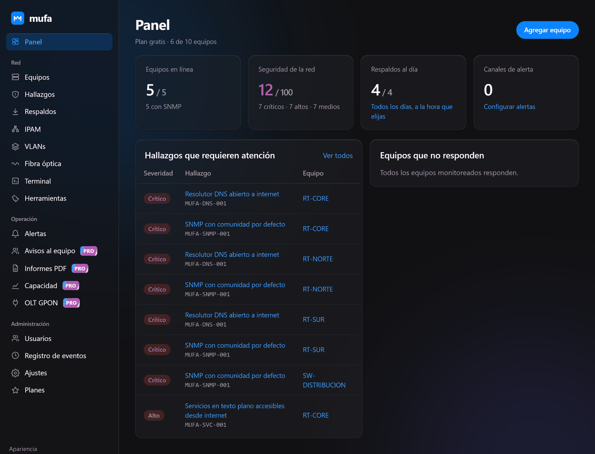
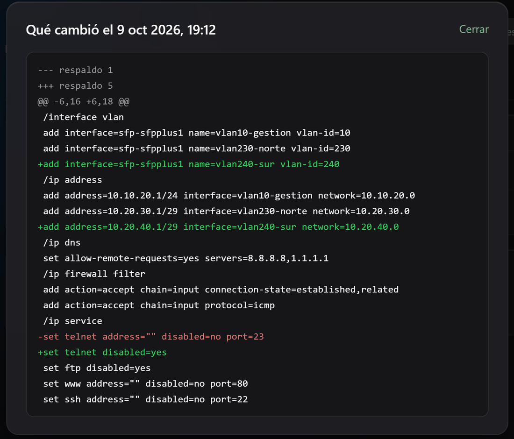
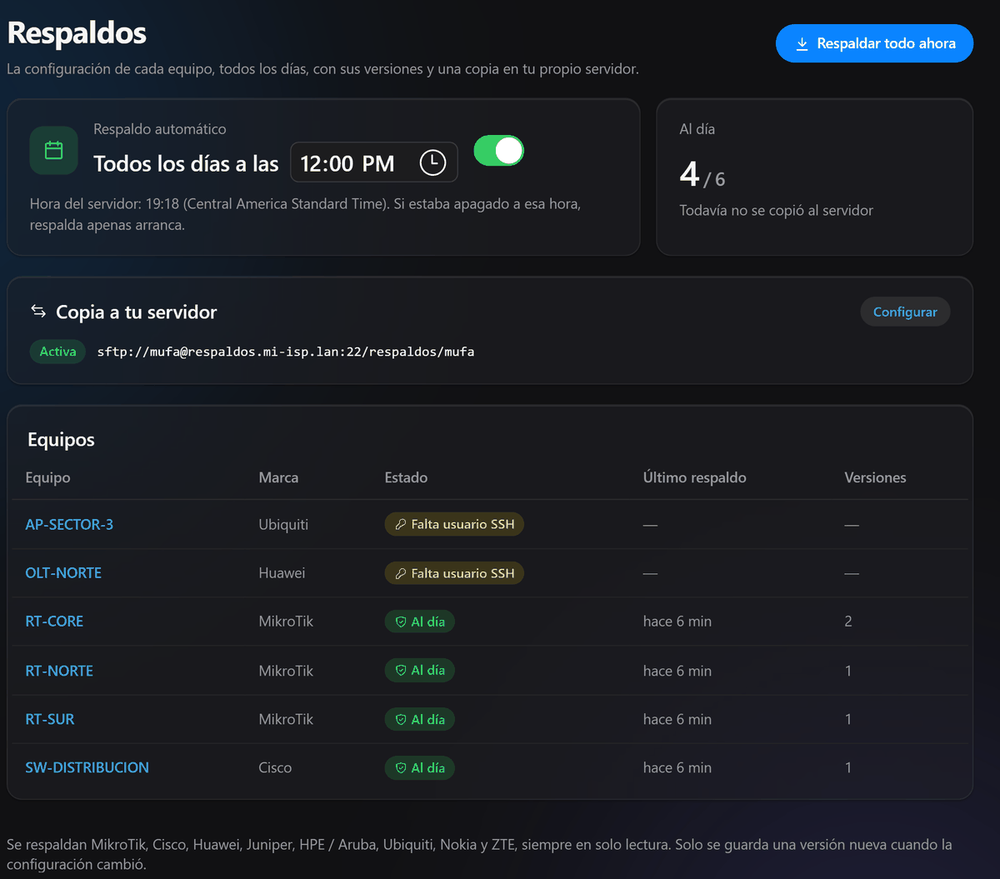
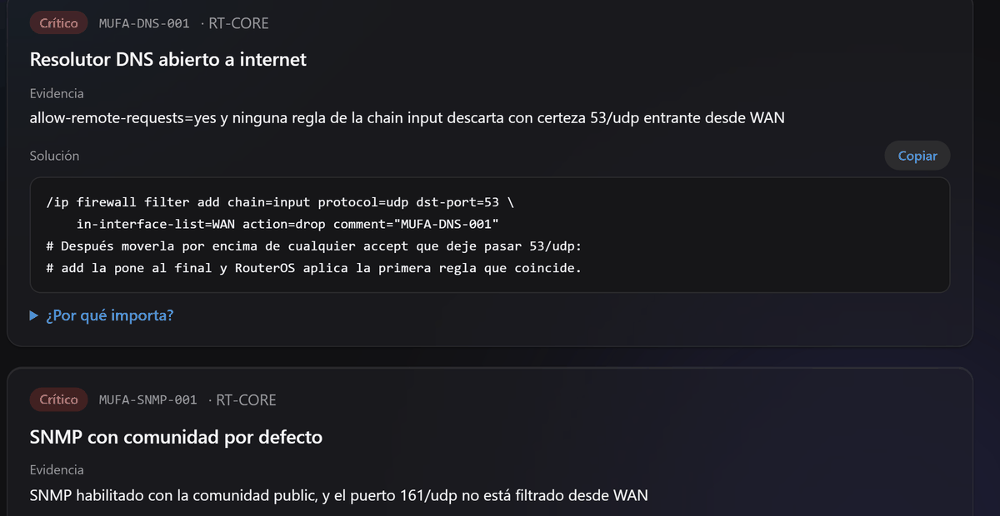
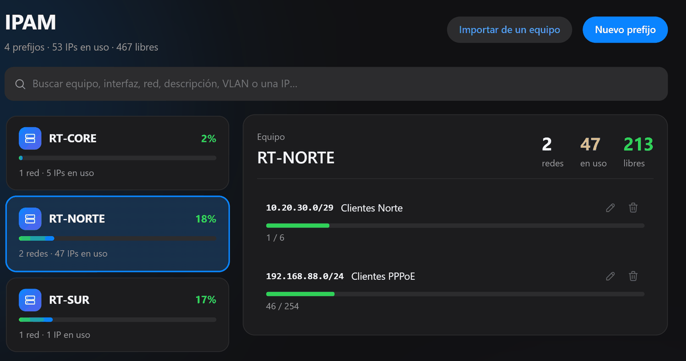
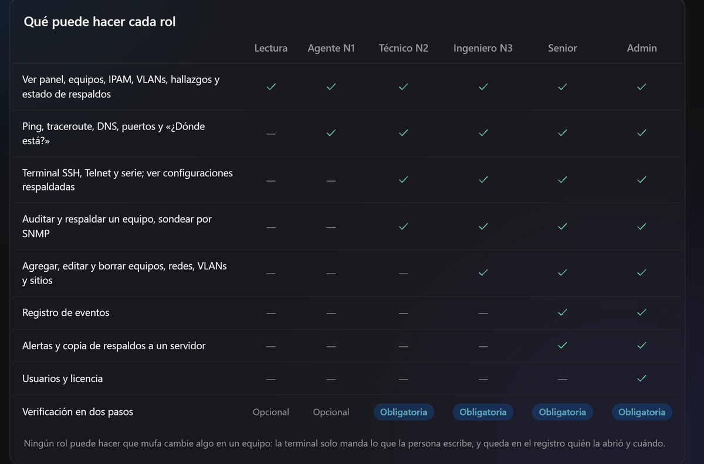

# mufa

**Monitoreo, auditoría, respaldos, IPAM y terminal para redes de ISPs, telcos
y data centers.** Multimarca, en español y en tu propio servidor o
computadora: tus datos no salen de tu red.

mufa está pensado para que lo use desde el ingeniero senior hasta el técnico
que recién sacó su CCNA o MTCNA: cada hallazgo trae la evidencia exacta, la
solución lista para copiar y por qué importa.

> Estado: en desarrollo (0.x). Este repositorio es la **edición gratuita**:
> completa para redes chicas, hasta 10 equipos.

<p align="center">
  <a href="https://apps.microsoft.com/detail/9PG9ZPWQ6G2Q"><b>Microsoft Store</b></a>
  &nbsp;·&nbsp;
  <a href="https://github.com/DecoTaco22/mufa/releases/latest"><b>Descargar para Windows, Mac o servidor</b></a>
  &nbsp;·&nbsp;
  <a href="https://mufa.pages.dev">Sitio web</a>
  &nbsp;·&nbsp;
  <a href="docs/SEGURIDAD.md">Seguridad</a>
</p>



## Qué hace

**Monitoreo**
- SNMPv3 con autenticación y cifrado por defecto, para cualquier marca:
  estado, tiempo encendido, tráfico por interfaz, caídas y reinicios.
- Al probar la conexión SNMP, mufa completa solo el nombre, la marca, el
  modelo y el número de serie del equipo.
- Si un equipo no responde por SNMP, distingue "caído" de "encendido pero
  con SNMP mal configurado".
- Alertas por Telegram, correo o webhook firmado.

**Auditoría y respaldos** (solo lectura)
- Auditoría de seguridad por SSH, por la API de RouterOS o subiendo un export:
  resolutores DNS abiertos, servicios expuestos a internet, comunidades SNMP
  por defecto, versiones con vulnerabilidades conocidas.
- Respaldos diarios cifrados a la hora que elijas (12:00 por defecto): guarda
  una versión solo si algo cambió y muestra las diferencias.
- Copia automática de los respaldos a tu propio servidor por SFTP, FTPS o FTP,
  en una carpeta por equipo o por día.

<table>
  <tr>
    <td width="50%"></td>
    <td width="50%"></td>
  </tr>
  <tr>
    <td align="center"><sub>Qué cambió en la configuración, línea por línea</sub></td>
    <td align="center"><sub>Respaldo diario y copia a tu servidor</sub></td>
  </tr>
</table>



**Documentación de la red**
- **IPAM:** redes agrupadas por equipo con su porcentaje de uso, mapa de IPs
  libres y en uso, buscador, siguiente IP libre e importación directa desde
  el equipo.
- **VLANs** por dominio de capa 2, sin números repetidos, con el equipo y la
  interfaz donde está cada una.
- **Fibra óptica:** presupuesto óptico, dispersión, PON y potencia de SFP.



**Herramientas**
- **Terminal** SSH, Telnet y puerto serie dentro de la app, con pestañas y
  la lista de tus equipos. Verifica la clave de cada equipo como PuTTY.
- Ping, traceroute, MTR, DNS y puertos con la salida en vivo.
- Mapa de topología con los vecinos LLDP, CDP y MikroTik de cada equipo, y
  modo NOC a pantalla completa para el televisor del NOC.
- Buscador en las configuraciones respaldadas de todos los equipos (y en las
  versiones anteriores).
- "¿Dónde está?": busca una IP o una MAC en las tablas ARP y de bridge de
  todos tus equipos.
- Calculadora IP: `/24` → `255.255.255.0`, wildcard, hosts y subredes.

**Equipo**
- Usuarios con seis roles, verificación en dos pasos y registro de todo lo
  que pasa.


- Tema oscuro, claro o automático; funciona también en el celular.

**Marcas:** cualquiera con SNMP para monitoreo. Respaldos por SSH: MikroTik,
Cisco, Huawei, Juniper, HPE / Aruba, Ubiquiti, Nokia y ZTE. Auditoría de
seguridad: MikroTik RouterOS y Cisco IOS / IOS XE (se van sumando más).

## Descargar

Desde [Releases](https://github.com/DecoTaco22/mufa/releases/latest):

| Descarga | Para qué | Cómo se usa |
|---|---|---|
| [**Microsoft Store**](https://apps.microsoft.com/detail/9PG9ZPWQ6G2Q) | Usarlo en tu PC (Windows 10 u 11) | **Lo recomendado:** se instala sin avisos de Windows y la tienda la mantiene al día |
| `mufa-instalador-windows.exe` | Usarlo en tu PC (Windows 10 u 11) | Se instala como cualquier programa: menú Inicio y desinstalador |
| `mufa-windows.zip` | Lo mismo, sin instalar (portátil) | Se descomprime y se abre `mufa.exe` |
| `mufa-macos.dmg` | Usarlo en tu Mac (chip Apple M1 o posterior, macOS 12 o más nuevo) | Se arrastra a Aplicaciones, como cualquier app de Mac |
| `mufa-servidor.zip` | Usarlo con todo tu equipo | Servidor Linux con Docker; se entra **desde el navegador** con HTTPS |

Cada versión publica sus sumas SHA-256 (`SHA256SUMS.txt`) para verificar la
descarga.

### En tu computadora (Windows o Mac)

1. Abre `mufa-instalador-windows.exe` (pide permiso de administrador para
   instalarse en Archivos de programa) o arrastra `mufa.app` a Aplicaciones
   (Mac).
2. La primera vez crea tu cuenta de administrador. Si ya usas mufa en otra
   computadora, elige **Ya tengo cuenta** y abre el archivo que descargaste
   allá en **Ajustes › Llevar a otra computadora**: entras con tu mismo
   usuario, tus equipos y tus respaldos.

Desde la [Microsoft Store](https://apps.microsoft.com/detail/9PG9ZPWQ6G2Q) se instala sin avisos. El instalador
`.exe` todavía no está firmado: Windows muestra "Windows protegió su PC"
(elige **Más información › Ejecutar de todas formas**) y macOS la bloquea la
primera vez (**Ajustes del Sistema › Privacidad y seguridad › Abrir
igualmente**). Los datos quedan en la carpeta `.mufa` de tu usuario y mufa
solo escucha en tu computadora: nadie más de la red puede entrar.

### En un servidor (para todo tu equipo, desde el navegador)

Requisitos: Linux de 64 bits (Intel o AMD) con Docker y 2 GB de RAM, que
alcanzan para cientos de equipos. Sirve una VM en Proxmox o VMware, o un VPS.

```bash
curl -fsSLO https://github.com/DecoTaco22/mufa/releases/latest/download/mufa-servidor.zip
unzip mufa-servidor.zip && cd mufa-servidor
sudo sh instalar.sh
```

El instalador revisa que Docker esté listo, pregunta con qué dirección van a
entrar (la IP del servidor o un dominio), arranca mufa y muestra la dirección
y el token para crear el administrador. Con un dominio público, Caddy obtiene
y renueva solo el certificado de Let's Encrypt; con una IP usa un certificado
propio (el navegador avisa la primera vez). A mufa solo se llega por HTTPS:
el contenedor no publica puertos.

Si ya usabas la app de escritorio, en la bienvenida elige **Ya tengo cuenta**
y abre el archivo de **Ajustes › Llevar a otra computadora**.

Para actualizar: descarga el `mufa-servidor.zip` nuevo, descomprímelo encima
(`unzip -o`) y vuelve a ejecutar `sudo sh instalar.sh`. Tu `.env` y tus datos
se conservan y la base se pone al día sola.

### Configuración del servidor

| Variable | Por defecto | Qué controla |
|---|---|---|
| `MUFA_DOMINIO` | `localhost` | Dominio del certificado HTTPS |
| `MUFA_HOSTS_PERMITIDOS` | el dominio | Nombres con que se acepta llegar al servidor |
| `MUFA_SONDEO_MINUTOS` | 5 | Cada cuánto se consulta por SNMP (0 lo apaga) |
| `MUFA_RESPALDO_HORAS` | 24 | 0 apaga los respaldos automáticos (la hora del día se elige en la app) |
| `TZ` | `UTC` | Zona horaria del servidor, por ejemplo `America/Guatemala` |
| `MUFA_RETENCION_DIAS` | 7 | Días de historial de tráfico |
| `MUFA_DURACION_SESION_HORAS` | 8 | Cuánto dura una sesión |
| `MUFA_ALERTAS` | 1 | 0 apaga el envío de alertas |
| `MUFA_BASE_DATOS` | SQLite en el volumen | URL de PostgreSQL (`postgresql+psycopg://...`) |

## Seguridad

mufa guarda el acceso a tu red, así que la seguridad va primero:

- **Solo lectura.** Monitoreo, auditoría y respaldos solo consultan: por SNMP
  nunca se envía un SET, y por SSH o la API solo se ejecutan comandos de una
  lista blanca exacta por marca (`src/mufa/security.py`).
  `tests/test_no_write.py` falla si aparece un comando fuera de la lista.
- **La terminal es tuya.** Es lo único que escribe en un equipo, y solo lo
  que tú tecleas: mufa no agrega ni ejecuta nada por su cuenta.
- **Credenciales cifradas** (Fernet), con la clave en un archivo aparte de la
  base. La API nunca las devuelve.
- **Verificación en dos pasos obligatoria** para todo rol que pueda usar las
  credenciales de los equipos.
- **Clave de cada equipo verificada:** si cambia, mufa no manda la contraseña.

Todo el detalle en [docs/SEGURIDAD.md](docs/SEGURIDAD.md). Para reportar una
vulnerabilidad, sigue [SECURITY.md](SECURITY.md) (no abras un issue público).

## Roles

Se entra con el usuario o el email.

| Rol | Puede | Dos pasos |
|---|---|---|
| Lectura | Ver equipos, monitoreo, hallazgos, IPAM, VLANs, fibra y el estado de los respaldos | Opcional |
| Agente N1 | Además, ping, traceroute, DNS, puertos y "¿Dónde está?" (sin entrar a los equipos) | Opcional |
| Técnico N2 | Además, auditar, respaldar, ver configuraciones y usar la terminal (a equipos del inventario) | **Obligatoria** |
| Ingeniero N3 | Además, administrar el inventario, IPAM, VLANs y el horario de respaldos, y conectarse a cualquier IP | **Obligatoria** |
| Senior | Además, ver el registro de eventos, configurar alertas y la copia de respaldos a un servidor | **Obligatoria** |
| Admin | Además, administrar usuarios y la licencia | **Obligatoria** |

La verificación en dos pasos funciona con cualquier app TOTP: Google o
Microsoft Authenticator, Contraseñas de Apple, 1Password, Bitwarden, Proton,
Authy, 2FAS o Aegis.

## Línea de comandos

Auditar sin servidor, contra un equipo o un export guardado:

```bash
uv run mufa audit 10.0.0.1 --user readonly
uv run mufa audit --offline router.rsc --format html -o informe.html
uv run mufa audit --offline running-config.txt --marca cisco
```

## Cómo evalúa el firewall (MikroTik)

mufa recorre la chain `input` en orden, como RouterOS, y sigue los `jump` a
chains propias. Solo da por bloqueado un tráfico si una regla lo descarta
con certeza. Si una regla usa un criterio que mufa no puede evaluar sin
conocer la red (`in-interface=ether1`, `src-address`, `limit`...), no se
asume que aplica: es preferible un aviso de más a decir "estás protegido"
sin saberlo. En Cisco todavía no se evalúan las ACL de las interfaces.

## Desarrollo

```bash
uv sync --all-groups
(cd web && npm ci && npm run build)       # la app web, con Node.js 24
uv run mufa crear-admin --usuario admin --nombre "Tu nombre"
uv run mufa servidor                      # http://127.0.0.1:8080
uv run mufa-escritorio                    # la app con ventana propia
uv run pytest
```

Cómo contribuir, la regla de datos sensibles y el estilo del código:
[CONTRIBUTING.md](CONTRIBUTING.md).

## Planes y apoyo

mufa es open-core: esta edición gratuita es completa para redes chicas
(hasta 10 equipos). Los planes de pago suman equipos ilimitados y módulos
para operar en equipo: avisos al NOC, informes en PDF, predicción de
capacidad y OLT GPON. Ver [docs/PLANES.md](docs/PLANES.md).

Pro es una membresía mensual en [Ko-fi](https://mufa.pages.dev/pro): la
licencia te llega por correo, se instala en **Ajustes › Plan** y se renueva
sola cada mes. Los primeros 150 [fundadores](https://mufa.pages.dev/fundador)
lo tienen a precio de fundador. Incluye:

- **Avisos al equipo:** tu bot de Telegram avisa a quien está de turno, con
  «Lo tomo yo» y escalamiento a los supervisores si nadie lo toma.
- **Informes en PDF** con tu logo: disponibilidad, caídas, saturación y
  seguridad del mes, por correo el día 1.
- **Predicción de capacidad** con un año de historial.
- **OLT GPON** Huawei y ZTE: cada ONU, su señal y los cortes por puerto PON.

## Licencia

Copyright (C) 2026 los autores de mufa.

Los módulos Pro (`src/mufa/pro/`) tienen su propia licencia comercial:
[LICENSE-PRO.md](LICENSE-PRO.md). Se publican cifrados; la licencia Pro
trae la llave para abrirlos y auditarlos.

[GNU AGPL v3](LICENSE): puedes usar, estudiar, modificar y redistribuir
mufa; si ofreces una versión modificada como servicio a otros, tienes que
publicar tus cambios bajo la misma licencia. Para usos que no encajen con la
AGPL hay licencias comerciales.
